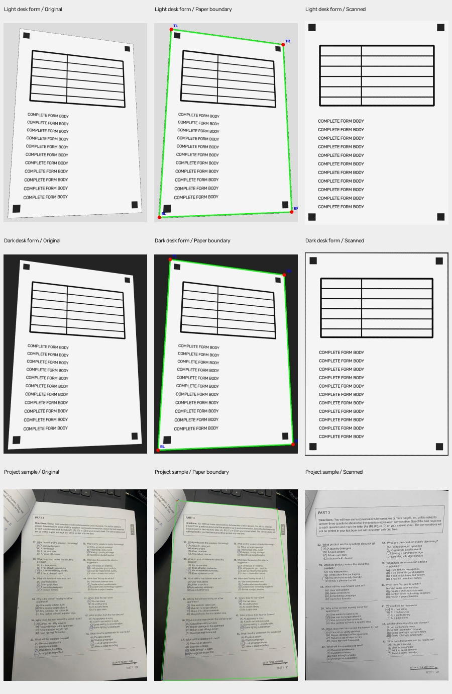

# Giữ ảnh chụp và tối ưu tốc độ scanner

## Hành vi giao diện

Khi bấm chụp, canvas giữ nguyên khung hình lấy từ video. Giao diện chuyển sang trạng thái `processing`, ẩn video và hiển thị canvas cho đến khi API scan trả kết quả. Khi thành công, bản quét được thêm vào danh sách và video hiện lại trên cùng camera stream. Khi lỗi, ảnh chụp được giữ lại để tải về, thử lại hoặc chụp lại.

Các nút chụp và chuyển camera bị khóa khi đang xử lý. Khung nhận diện trực tiếp tạm dừng và không được dùng để thay thế vùng cắt trong pipeline scan.

## Tối ưu giữ nguyên thuật toán

- `convolution2d`: thay vòng lặp từng pixel bằng sliding windows NumPy. Chia theo khối với bộ đệm tích khoảng 16 MiB; giữ nguyên float32, kernel lật hai chiều, padding và thứ tự cộng từng cửa sổ.
- Non-maximum suppression: so sánh các mảng láng giềng theo đúng các nhóm góc, quy ước đường chéo và điều kiện `>=` cũ. Biên ngoài vẫn bằng 0.
- Hysteresis: hàng đợi lan truyền từ strong tới weak liên thông 8 hướng; mỗi weak được nâng tối đa một lần. Giữ nguyên quy tắc không nâng weak ở hàng/cột ngoài cùng.
- Detector contour/Hough/brightness, xếp điểm, nắn phối cảnh, hệ số Gaussian và làm nét giữ nguyên. Không thay Canny tự cài bằng `cv2.Canny` cho pipeline scan.

## Số đo tại máy phát triển

Ảnh `test_image.jpg`: 1920×2560 BGR; đầu ra 1600×2120 xám. Cấu hình `detection_width=800`, `output_width=1600`, `verbose=False`, OpenCV một luồng. Các số dưới đây đo không bật profiler.

| Lần chạy | Thời gian xử lý |
| --- | ---: |
| Tham chiếu từ commit `8853341`, một lần | 43,897 giây |
| Bản tối ưu, lần 1 | 0,586 giây |
| Bản tối ưu, lần 2 | 0,589 giây |
| Bản tối ưu, lần 3 | 0,582 giây |
| Trung vị bản tối ưu | 0,586 giây |
| API cục bộ, gồm đọc JPEG và mã hóa PNG | 1,035 giây |

Đối chiếu trực tiếp với bản tham chiếu xác nhận **bốn góc, ảnh biên, NMS, ảnh nắn phối cảnh và ảnh làm nét trùng từng phần tử**. Ảnh PNG qua API giải mã ra cũng trùng từng pixel với ảnh làm nét tham chiếu.

SHA-256 của các pixel ảnh làm nét trong cả hai bản:

```text
6bb7f8fdc97fd698dcf4a8fedf773af79663dc631b3daf3e5c804c4792b3d10c
```

Đây là số đo trên một ảnh và một máy; chưa đo trọn luồng trên điện thoại/ngrok. Thời gian tải ảnh lên và tải PNG về phụ thuộc mạng, không nằm trong thời gian xử lý 0,586 giây.

## Chạy lại

PowerShell, từ thư mục dự án:

```powershell
.\.venv\Scripts\python.exe -X utf8 scripts/benchmark_scanner.py --reference-commit 8853341 --save "$env:TEMP\docuscan-reference.npz"
.\.venv\Scripts\python.exe -X utf8 scripts/benchmark_scanner.py --compare "$env:TEMP\docuscan-reference.npz" --repeat 3
.\.venv\Scripts\python.exe -X utf8 -m unittest discover -s tests -v
node --test tests/test_camera_flow.cjs
```

Kết quả kiểm thử sau thay đổi: 27 kiểm thử Python và 19 kiểm thử JavaScript đạt. Các kiểm thử mới so sánh với phép tính vô hướng cũ, gồm kernel bất đối xứng, nhiều chế độ padding, nhiều khối, góc NMS biên, plateau, chuỗi weak dài và weak ở mép ảnh. Kiểm thử giao diện mô phỏng API bị chậm và camera đổi hướng để xác nhận canvas giữ nguyên ảnh đến khi scan hoàn tất.

## Cập nhật chất lượng ảnh chụp

Sau khi tối ưu tốc độ, bổ sung các thay đổi để giữ chi tiết chữ:

- Camera trực tiếp yêu cầu độ phân giải ưu tiên 2560×1920, dùng `ideal` để thiết bị tự chọn mức hỗ trợ. Chỉ thử lại cấu hình cơ bản khi trình duyệt báo `OverconstrainedError`.
- Yêu cầu lấy nét liên tục khi camera công bố hỗ trợ; nếu điều khiển lấy nét bị từ chối, vẫn cho chụp bình thường.
- JPEG từ canvas dùng chất lượng 0,98 thay vì 0,92.
- Nút HD mở file input với `capture=environment` để người dùng chụp bằng giao diện camera của điện thoại. JPEG/PNG được gửi nguyên bản, không thu nhỏ hay mã hóa lại ở trình duyệt; các định dạng khác chỉ được đổi sang JPEG nếu trình duyệt đọc được.
- API multipage giữ `detection_width=800` và cùng detector/cách nắn giấy. Giới hạn chiều rộng đầu ra tăng từ 1600 lên 2400; ảnh nhỏ không bị phóng lớn. Vì thay đổi giới hạn đầu ra, không so hash ảnh chất lượng mới với hash của cấu hình 1600 ở bảng lịch sử phía trên.

Đo lại API trên cùng ảnh 1920×2560: 0,952 giây, đầu ra 1826×2419, PNG 2.298.189 byte. Đây vẫn là đo trên máy cục bộ, chưa tính truyền ảnh điện thoại/ngrok. Kiểm thử ảnh giấy độ phân giải cao xác nhận bốn góc không đổi trong khi giữ được chiều rộng ảnh lớn hơn mức 1600 cũ. Tổng cộng 28 kiểm thử Python và 25 kiểm thử JavaScript đạt.

Các thay đổi này áp dụng cho ảnh chụp mới; không phục hồi được chi tiết vốn đã thiếu trong ảnh chụp mờ. Chất lượng lấy nét và độ phân giải thực nhận vẫn phụ thuộc thiết bị. Nút HD cho phép chọn đường chụp ảnh thay cho khung hình video khi cần.

Tài liệu API tham khảo: [ràng buộc camera](https://developer.mozilla.org/en-US/docs/Web/API/Media_Capture_and_Streams_API/Constraints), [thuộc tính focusMode](https://developer.mozilla.org/en-US/docs/Web/API/MediaTrackConstraints), [camera capture trên file input](https://developer.mozilla.org/en-US/docs/Web/HTML/Reference/Attributes/capture).

## Sửa cắt form chụp nghiêng khi tải ảnh hàng loạt

Đã tái hiện trường hợp nền sáng gần màu giấy: contour/Hough chọn bảng in bên trong thay cho trang giấy, nên API trả ảnh bị thiếu nội dung dù vẫn báo thành công. Bản sửa bổ sung các ngưỡng sáng để tìm vùng giấy và kiểm tra tương phản trong/ngoài ở các cạnh. Một tứ giác bao ngoài được xác nhận sẽ được ưu tiên so với khung bảng nhỏ nằm trong nó.

Vùng giấy sáng được xấp xỉ bằng bốn đỉnh thực, giữ dạng hình thang do phối cảnh; không thay nó bằng chữ nhật xoay từ `minAreaRect`. Ảnh scan đã kín khung được giữ đầy đủ thay vì cắt tiếp vào bảng in. Việc xếp góc dùng thứ tự quanh tâm, tránh chọn trùng một điểm khi xoay 45°; các giao điểm Hough suy biến được bỏ qua để xét ứng viên tiếp theo.

Kiểm thử thêm: nền sáng/tối, nhiều hình thang nghiêng, API tải bốn ảnh liên tiếp, ảnh đã scan kín khung và tất cả hoán vị của tứ giác xoay 45°. Các dấu kiểm tra gần cả bốn góc giấy đều được giữ sau khi nắn trong bộ ảnh thử. Tổng cộng 35 kiểm thử Python và 25 kiểm thử JavaScript đạt. Ảnh gốc của bộ form trong ảnh chụp màn hình chưa có trong workspace, nên chưa thể khẳng định kết quả trên chính bộ ảnh đó.

Ảnh kiểm tra gồm đầu vào, khung giấy và kết quả nắn:



Đo lại pipeline trên ảnh 1920×2560 với đầu ra giới hạn 1600: 0,672 / 0,631 / 0,642 giây; ảnh mẫu này vẫn có hash pixel giống mốc kiểm chứng trước. Đây không phải đánh giá tốc độ qua ngrok.

## Kiểm chứng lại trên đúng ảnh đề thi đặt trên bàn phím

Đã tìm được ảnh gốc `z7865204563138_6d91bb0e96dfc2f68f3713201c129354.jpg` (960×1280) trong máy. Bản trước chọn giao điểm Hough tại góc trên trái x≈22, y≈139, gồm cả bản lề và bàn phím. Bộ kiểm thử tổng hợp trước đó không bao phủ trường hợp này.

Bổ sung bước kiểm tra vùng giấy bằng GrabCut trên ảnh có cạnh dài tối đa 480 pixel. Mô hình màu tiền cảnh được khởi tạo từ phần sáng phía trong khung; nền chắc chắn nằm ngoài khung đã nới rộng. Chỉ thay khung khi tìm được một vùng giấy bốn cạnh, vùng khớp contour, nằm gần trọn trong đề xuất cũ và loại bỏ ít nhất 10% diện tích nền. Chênh lệch nhỏ được giữ nguyên để tránh cắt thêm một khung vốn đã đúng. Canny, Hough và phép biến đổi phối cảnh trên ảnh gốc vẫn được sử dụng.

Với ảnh báo lỗi, bốn góc mới xấp xỉ `(149,213), (859,173), (928,1235), (136,1264)`, đầu ra 792×1063, không còn dải bàn phím. Một lần đo pipeline cục bộ gồm bước vùng giấy và làm nét: 0,773 giây. Đây không bao gồm thời gian truyền qua ngrok. Giấy có cong ở hai mép; biến đổi phối cảnh bốn điểm xử lý độ nghiêng nhưng không phải phép làm phẳng mặt giấy cong.

Trong màn hình xem ảnh, **Chỉnh 4 góc** mở lại ảnh gốc và khung thực mà lần scan đã dùng. Có thể kéo từng điểm bằng chuột/cảm ứng hoặc dịch từng pixel bằng phím mũi tên (Shift: 10 pixel). **Nắn lại ảnh** gửi ảnh gốc nguyên bản và bốn góc đã xác nhận tới `/api/multipage/rectify`; không dùng tọa độ gợi ý từ camera và không nắn tiếp từ PNG đã xử lý. Kết quả thay đúng trang trong thư viện/PDF. Hủy hoặc xử lý lỗi giữ kết quả cũ. JPEG có EXIF xoay được kiểm tra cùng hệ tọa độ khi hiển thị.

Kiểm thử: 42 kiểm thử Python khi cung cấp ảnh gốc cục bộ, 30 kiểm thử JavaScript mô phỏng. Chrome headless thật cũng đã kiểm tra tải hai ảnh, kéo góc bằng pointer, chỉnh bằng phím, lưu qua API, thay đúng trang, hủy và bố cục 390×844 / 1440×1000. Không phát hiện lỗi JavaScript trong lượt kiểm tra đó. Ảnh gốc và ảnh chụp màn hình kiểm tra được giữ ngoài Git.

Chạy kiểm tra ảnh báo lỗi (đường dẫn trỏ tới ảnh gốc đã nêu):

```powershell
$env:DOCUSCAN_REGRESSION_IMAGE = 'DUONG_DAN_ANH_GOC.jpg'
.\.venv\Scripts\python.exe -X utf8 -m unittest discover -s tests -p 'test_*.py'
node --test tests/test_camera_flow.cjs
node tests/browser_crop_smoke.cjs "$env:DOCUSCAN_REGRESSION_IMAGE" docs/browser-crop-review
```

Ảnh đã scan trước khi cập nhật không tự thay đổi. Cần tải lại giao diện và chọn lại ảnh gốc để chạy bản mới.

## Sửa khung trên ảnh giấy xoay chéo giữa nhiều vật sáng

Ảnh 1920×2560 được báo lỗi tiếp theo cho thấy điểm bên trái của khung nằm trên mép bàn. Đã tái hiện trên ảnh gốc ở cả trang quét một ảnh và API quét hàng loạt. Hai lỗi được sửa:

- NMS của Canny đã so sánh nhầm hai cặp láng giềng chéo. Với tọa độ mảng có y hướng xuống, gradient +45° cần so NW/SE, còn 135° cần so NE/SW. Lỗi này làm đứt các cạnh giấy xiên; sau khi sửa, Hough tìm được khung giấy mà trước đó trả `None`.
- Quy tắc lấy điểm có x+y nhỏ nhất làm góc đầu có thể chọn góc dưới trái trong một ảnh giấy dọc chụp chéo. Thứ tự quanh tâm được giữ lại, nhưng cạnh phía trên được chọn theo trung điểm cạnh để không xoay ngang kết quả trong trường hợp này.

Bước tách vùng cũng bổ sung kiểm tra sắc độ Lab a/b so với vùng giấy sáng. Vùng khác màu rõ rệt, như bàn tay chạm giấy, được loại khỏi mô hình giấy mà không loại bóng tối trên giấy chỉ vì độ sáng thấp. Thay đổi này chỉ dùng để tìm khung; ảnh xuất vẫn được nắn từ pixel gốc.

Kết quả kiểm tra HTTP trên server đang chạy: API trả PNG 1269×1563 với bốn góc xấp xỉ `(1002,428), (1850,861), (978,2159), (0,1349)`; ảnh được dựng dọc và giữ đầy đủ phần bảng. Bước xác định giấy của trang quét một ảnh dùng cùng khung. Một lượt đo API cục bộ là 1,000 giây gồm đọc/mã hóa ảnh; trang quét một ảnh là 0,766 giây. Chưa bao gồm đường truyền điện thoại/ngrok.

45 kiểm thử Python và 30 kiểm thử JavaScript đạt. Các kiểm thử mới xác nhận trực tiếp cặp láng giềng theo hướng gradient, tất cả hoán vị của bộ góc chụp chéo, hai route trên chính ảnh báo lỗi, và ảnh đề thi cũ với nhiều trạng thái khởi tạo bộ tách vùng. Cấp đường dẫn ảnh chéo qua `$env:DOCUSCAN_DIAGONAL_IMAGE` để chạy kiểm tra ảnh này cục bộ; ảnh người dùng không được đưa vào Git.

Việc sửa NMS thay đổi ảnh biên và có thể thay đổi góc/ảnh cuối. Các kết quả trùng hash với bản Canny cũ ghi ở các phần trước là số đo lịch sử, không phải điều kiện đúng cho bản sửa hình học hiện tại.

## Giữ vùng toàn trang khi nhập lại ảnh đã nắn

Tái hiện trên `f55cb5e0060b_final.jpg` 1000×1221: ảnh đã được nắn nhưng bộ dò chọn khung in bên trong tại khoảng `(0,393), (287,398), (405,809), (11,809)`. Phần nền giấy có bóng và ảnh minh họa tối khiến điều kiện giữ nguyên ảnh kín khung trước đó không đạt.

Bổ sung kiểm tra vùng giấy phủ gần toàn ảnh theo độ sáng tương đối, 16 ô không gian và các góc. Các ô chứa ảnh minh họa được cho phép tối hơn; giấy cần hiện diện ở phần lớn ảnh và các góc. Vẫn ưu tiên một khung giấy bên ngoài đã xác nhận khi có khung đó. Khi chọn toàn ảnh, tọa độ được đặt lại đúng biên ảnh gốc sau khi scale từ ảnh detection, tránh sai lệch do kích thước resize được làm tròn. Phép nắn phối cảnh cho các vùng đã chọn được giữ nguyên.

Màn hình chỉnh góc có thêm **Toàn bộ ảnh**, đưa bốn điểm về `(0,0), (1,0), (1,1), (0,1)` theo tọa độ chuẩn hóa. Nút chỉ đổi khung đang chỉnh; người dùng vẫn bấm **Nắn lại ảnh** để áp dụng.

Đã xác nhận API trên server đang chạy trả bốn góc toàn ảnh cho đúng file báo lỗi. Kiểm thử trên Chrome xác nhận khung ban đầu bao toàn ảnh, nút chọn toàn ảnh, kéo/chỉnh góc, lưu và bố cục điện thoại/máy tính. 47 kiểm thử Python và 31 kiểm thử JavaScript đạt, bao gồm ảnh đã nắn có bóng và các ảnh chụp nghiêng trước đó. Đặt thêm `$env:DOCUSCAN_RECTIFIED_IMAGE` tới file ảnh đã nắn để chạy kiểm tra cục bộ trên ảnh này.

## Bản quét trong màn hình So sánh

Trước đây `/?tab=compare` chỉ tạo sáu ảnh biên và hiển thị ảnh gốc trong tổng quan; không có bước tìm giấy/nắn/làm nét. Trang so sánh nay gọi `compare_algorithms(..., max_width=800, include_scans=True)` để tạo thêm bản quét cho từng phương pháp. Lời gọi hàm không có `include_scans` vẫn chỉ so sánh ảnh biên như trước.

Mỗi ảnh biên riêng được đưa qua ngưỡng Otsu và chuyển vào `scan_document(edge_image=...)`. Scanner kiểm tra kích thước ảnh biên khớp ảnh detection, dùng đúng ảnh biên đã cung cấp và bỏ qua việc tính lại Canny. Các bước tìm giấy, scale góc về ảnh gốc, nắn phối cảnh và Unsharp được dùng chung; ảnh xuất giới hạn rộng 1000 như trang quét một ảnh. Không lấy một bản quét Canny rồi gắn nhãn sáu thuật toán khác nhau. Vùng giấy sáng và bước tách vùng vẫn là các cơ chế hỗ trợ chung; giao diện ghi nguồn khung của từng bản quét.

Theo yêu cầu giao diện, khu vực sáu thuật toán giữ cách trình bày cũ: ảnh biên, thời gian tạo biên và nút tải ảnh biên. Các nút chuyển bản quét/khung giấy và tải bản quét trong từng ô được bỏ. Phần tổng quan vẫn hiển thị và cho tải bản quét của nhánh Canny nếu nhánh này có kết quả; nếu không thì dùng một nhánh có kết quả, ghi rõ tên. Nếu cả sáu không tìm được giấy, tổng quan ghi 0/6 và các ô vẫn cho xem/tải ảnh biên. Luồng xử lý và chọn bản quét tổng quan được giữ nguyên.

Khung tìm được và chất lượng cắt có thể khác nhau giữa các phương pháp. Việc tạo được tứ giác không chứng minh khung đó là đúng trang giấy. Trên ảnh chụp chéo đã báo lỗi, Canny cho khung và bản quét như trang Quét tài liệu; một số phương pháp khác còn chọn cả nền bàn. Dữ liệu quét từng nhánh vẫn có trong kết quả xử lý, còn giao diện các ô chỉ đối chiếu ảnh biên.

Để giảm chi phí của so sánh, LoG zero-crossing dùng các lát mảng 3×3 để tính min/max cho toàn ảnh thay cho vòng lặp Python từng pixel. Kiểm thử đối chiếu vô hướng xác nhận giữ nguyên đổi dấu, ngưỡng `>=` và biên ảnh. Một lượt chạy trực tiếp trên ảnh 1920×2560 mất 5,244 giây cho cả sáu luồng; thời gian trên trình duyệt/server có thể cao hơn khi máy đang chạy đồng thời các kiểm thử. So sánh xử lý sáu bản quét, vì vậy không đồng nhất thời gian với một lần quét tài liệu.

54 kiểm thử Python đạt ở lượt bổ sung luồng quét, gồm kiểm tra truyền đúng ảnh biên của từng thuật toán, không chạy lại Canny khi đã có biên, đầu ra Canny trùng trang quét, lỗi một nhánh, lỗi cả sáu và các file PNG. Kiểm tra giao diện được cập nhật để xác nhận sáu ô hiển thị ảnh biên như cũ và vẫn giữ bản quét Canny ở tổng quan. Script Chrome kiểm tra gửi form, sáu link tải ảnh biên, tải PNG ở tổng quan, bố cục 1440×1000 / 390×844 và ảnh không có giấy.

```powershell
node tests/browser_comparison_smoke.cjs DUONG_DAN_ANH.jpg docs/browser-crop-review/comparison-review
```

## Chọn một mặt phẳng, tránh gộp màn hình với bàn phím

Ảnh tham chiếu tiếp theo cho thấy khung chọn kéo từ mép màn hình xuống bàn phím, trong khi khung mong muốn chỉ bao màn hình. Chưa có tệp ảnh gốc lớp học trong workspace để đối chiếu chính ảnh đó. Bộ kiểm tra bổ sung dùng cảnh mô phỏng có màn hình, bàn phím, khung bảng phía sau và cửa sổ nhỏ trong màn hình; ảnh giấy thật trước đó vẫn được kiểm tra lại.

`find_supported_surface` xét cả contour lồng bên trong qua `RETR_LIST`, trên ảnh biên gốc và các mức nối khe nhỏ. Không dùng convex hull để ép một đường bao gãy góc của cả laptop thành một tứ giác. Ứng viên cần khớp contour, đủ diện tích, có đủ bốn cạnh liên tục và hướng gradient phù hợp. Độ tương phản ở hai phía mỗi cạnh giúp phân biệt ranh giới bề mặt với các đường kẻ in trên cùng trang giấy. Cạnh yếu nhất được tính vào điểm thay vì chỉ lấy trung bình; diện tích không còn đủ để một khung lớn lấn át khung màn hình rõ cạnh.

Khi contour còn đứt, các giao điểm Hough được xét bằng cùng tiêu chí. Các ứng viên Hough của lượt dò ban đầu được tái sử dụng trong lượt quét cuối; bản đồ hỗ trợ biên cũng được tính một lần thay vì dilate lại cho từng tứ giác. Khung giấy bao ngoài vẫn được bảo vệ khi có bằng chứng mép giấy và viền giấy sáng, kể cả khi một ảnh minh họa lớn chiếm giữa trang. Ảnh đã scan kín khung giữ nguyên quy tắc toàn ảnh.

API hướng dẫn camera dùng `detect_document(..., preview_only=True)` với cùng cách đánh giá ứng viên; bỏ qua bước tách vùng màu chậm. Lượt scan cuối tiếp tục tính trên chính ảnh chụp, không dùng một khung hướng dẫn cũ để thay tọa độ. Khoảng nghỉ sau khi hoàn tất một lượt hướng dẫn giảm từ 900 xuống 350 ms; các lượt vẫn tuần tự, không tạo nhiều request song song. Đây không phải cam kết tốc độ khung hình cố định vì còn phụ thuộc thời gian xử lý và mạng.

Kiểm tra bổ sung: màn hình sáng/tối, ảnh đơn sắc, camera xoay, ảnh giảm sáng, giấy có bảng kẻ và ảnh minh họa lớn, API hướng dẫn và API scan đều loại vùng bàn phím trong cảnh thử. 59 kiểm thử Python của cả bộ đạt, sau đó kiểm tra bổ sung ảnh đơn sắc cũng đạt; 31 kiểm thử JavaScript đạt. Chrome dùng nguồn video Y4M mô phỏng đã kiểm tra trực tiếp khung hướng dẫn, hai lần chụp tự scan liên tiếp, camera tiếp tục mở, xem kết quả màn hình theo chiều ngang và tải ảnh từ máy.

Các artefact thử cục bộ nằm trong `docs/browser-crop-review/surface-review/` và được loại khỏi Git. Đây là cải thiện bộ dò hình học, chưa phải bằng chứng đạt độ chính xác của CamScanner trên mọi cảnh. Một khung chữ nhật khác có đủ bằng chứng vẫn có thể gây nhầm khi cảnh có nhiều mặt phẳng tương tự.
